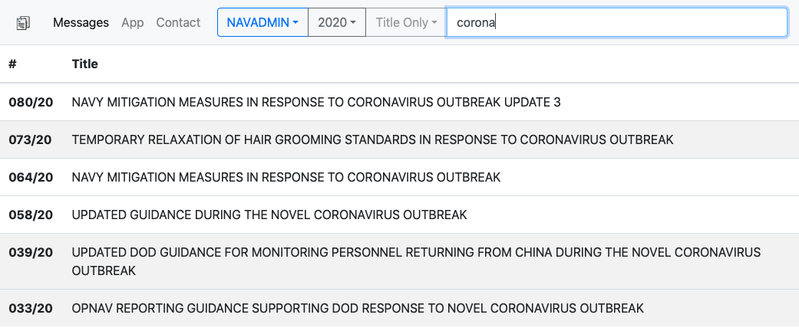

## NAVADMIN Viewer web app

A fully featured [web app](https://navadmin-viewer.github.io/) for viewing Navy and Marine Corps administrative messages — a taste of the native apps.

## 🌐 Browser support tested 23NOV2026

 |  |  | |  |
--- | --- | --- | --- | --- |
 Chrome | IE 11 | Edge | Safari | Firefox |
 144 ✔ | 11 ✔ | 134 (🪦 v44) ✔ | 13 ✔ | 75 ✔ |

## 📝 How to use

1. Go to [https://navadmin-viewer.github.io/](https://navadmin-viewer.github.io/).
2. Select the message type and year to browse.
3. Click the message you want to view.

Cross-year search works across years for the selected message type. **Title Only** searches message subjects. **Full Message** searches downloaded message bodies and shows literal matches first, followed by typo-tolerant results.

IE11 and other browsers without Unicode property escapes use literal search. To disable fuzzy search for all browsers, remove the `js/message-search-fuzzy.js` script tag from `index.html`.

## 📡 Offline mode (added 17MAR2025)

The web app downloads messages for the viewed year. The year menu shows a ✓ when the year's downloads are saved in the persistent store (IndexedDB). If IndexedDB is unavailable or rejects writes, a yellow progress bar shows downloads kept in the in-memory store. These downloads are available in the current tab until you reload or close it. Choose **Download all years** to download every year for the current message type.

When IndexedDB reports that the persistent store is full, the viewer can move downloaded message bodies for the oldest eligible year of one message type to the in-memory store to make room for newer messages. You can open and search them in the current tab until you reload or close it. Titles stay searchable after reload. Years you are viewing or downloading are protected.

You can Save (Ctrl-S/Cmd-S) the main website to your computer to use when fully offline because some browsers may not load the online main page without an internet connection (even when the messages are already locally stored). Either save the main site locally or don't navigate away to another website while away from internet.

### 🔗 Sharing link parameters

You can create links which will automatically display a specific message by adding parameters to the URL. 

Examples:
> NAVADMIN 104/2020 ▶ https://navadmin-viewer.github.io/?type=NAVADMIN&year=2020&number=104
> 
> ALNAV 038/2020 ▶ https://navadmin-viewer.github.io/?type=ALNAV&year=2020&number=38
> 
> NAVADMIN 188/2020 (with redirect to installed app) ▶ https://navadmin-viewer.github.io/view-message/?type=NAVADMIN&year=2020&number=188

**Tip:**
*Adding `/view-message/?` path at the end of the URL before parameters will automatically launch the native NAVADMIN Viewer iOS and Android apps if installed. The page will be redirected to the `/` path before displaying the message on Desktop and if no app installs are detected.*

Parameter | Allowed Values | Description |
--- | --- | --- |
`type` | `NAVADMIN`, `ALNAV`, `MARADMIN`, `ALMAR` | The message type. |
`year` | 20xx | The message year. |
`number` | xxx | The message number. |

### ❔ FAQ

See the main [FAQ](https://github.com/navadmin-viewer/?view_as=public)

### 🎉 Credits

All original code in NAVADMIN Viewer web client is available under terms of GPL-3.0.

NAVADMIN Viewer web client uses assets from the following projects. Thank you to all contributors of these projects.

- [Bootstrap](https://getbootstrap.com)

- [jQuery](https://jquery.com)

- [core-js](https://github.com/zloirock/core-js)

- [MiniSearch](https://github.com/lucaong/minisearch)

- [FireFormat.Info](https://www.fileformat.info/)

- [airra/browser-logos](https://github.com/alrra/browser-logos)
